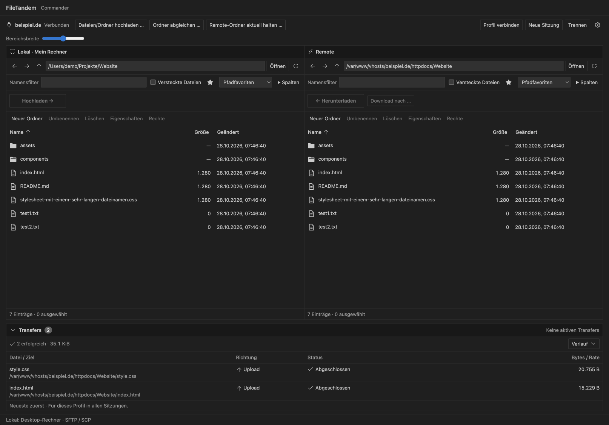
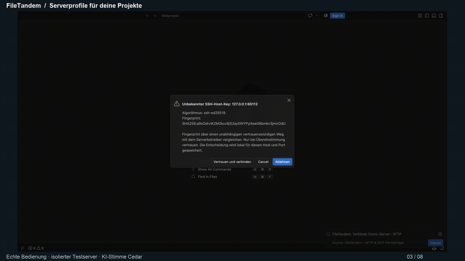

<p>
  
</p>

# FileTandem

[English](README.md) · **Deutsche Anleitung**

**Version 1.0.4** · SFTP- und SCP-Dateimanager für VS Code Desktop · MIT-Lizenz

Lokale Dateien und Serverdateien nebeneinander – direkt in Visual Studio Code. Mit FileTandem verwaltest du Dateien über **SFTP und SCP**, überträgst ganze Ordner und bearbeitest Remote-Dateien im Editor.

**[Im Marketplace installieren](https://marketplace.visualstudio.com/items?itemName=RootShellForge.filetandem)** · [Änderungen](CHANGELOG.md) · [Fehler melden](https://github.com/DrWhiteLetter/FileTandem/issues)



*Aktuelle Oberfläche mit synthetischen Testdaten; kein echter Transfer in dieser Aufnahme.*



*Historische Aufnahme: 27 Sekunden, ohne Ton; Ausschnitte aus Version 1.0.1 (Transferleiste vor der Überarbeitung in 1.0.4), deutsche Oberfläche. [Ablauf als Text](docs/first-transfer-feedback.md).*

## Was kann FileTandem?

- Zwei Dateibereiche mit Filtern, Sortierung, Mehrfachauswahl und Pfadfavoriten.
- Ohne Serverprofil zwei lokale Ordner unabhängig öffnen und Dateien oder Ordner in beide Richtungen kopieren.
- Dateien und Ordner hoch- und herunterladen, mit Fortschrittsanzeige, aufräumbarem Transferverlauf und geprüfter SFTP-Fortsetzung.
- Serverprofile speichern; Anmeldung per Passwort, SSH-Schlüssel oder SSH-Agent.
- Remote-Dateien öffnen, Änderungen vergleichen und Bearbeitung gezielt freigeben.
- Ordner mit Vorschau abgleichen oder lokale Änderungen automatisch hochladen.
- Ausschlussregeln für Dateiendungen, Namen und Punktdateien; Remote-Löschsicherungen als `.bak`.
- Deutsche und englische Oberfläche passend zur VS-Code-Anzeigesprache, helle und dunkle Themes.

## Installation

1. In VS Code die **Erweiterungen** öffnen und nach `@id:RootShellForge.filetandem` suchen.
2. **FileTandem – SFTP/SCP File Manager** von **RootShellForge** installieren.
3. Über die Befehlspalette **FileTandem: Dateimanager öffnen** starten.

Benötigt **VS Code Desktop ab 1.140.0**. Node.js ist für die Installation nicht nötig. [Marketplace-Eintrag öffnen](https://marketplace.visualstudio.com/items?itemName=RootShellForge.filetandem).

Alternativ eine verfügbare VSIX aus den [GitHub Releases](https://github.com/DrWhiteLetter/FileTandem/releases/latest) herunterladen und über **Erweiterungen → … → Aus VSIX installieren …** installieren. Die dort angebotene Version kann vom Marketplace abweichen.

### Getestete Desktop-Umgebungen

| Plattform | Nachweis |
| --- | --- |
| macOS mit Apple Silicon | Automatisierte lokale Release- und Installationstests; Details im [Release-Nachweis](docs/nachweise/Release-1.0.1.md). |
| Windows | Erfolgreicher manueller Desktop-Test, vom Projektinhaber bestätigt. OS-/VS-Code-Version und Architektur wurden nicht gesondert dokumentiert. [Nachweis](docs/nachweise/Windows-Desktop.md). |
| Debian 13.7, Xfce, ARM64 | Erfolgreicher manueller Test mit VS Code 1.145.0 (`code_1.145.0-1793748906_arm64.deb`), vom Projektinhaber bestätigt. [Nachweis](docs/nachweise/Linux-Desktop.md). |

Diese Nachweise sind keine Zusage für jede Distribution, Architektur oder Remote-Umgebung. macOS Intel, weitere Linux-Desktops sowie spezielle WSL-/Container-/UNC-Kombinationen sind nicht pauschal abgenommen. Eine vollständige manuelle Screenreader-Abnahme steht noch aus.

## Lokal arbeiten

**Lokalen Dateimanager öffnen** zeigt zwei lokale Ordner. Öffne links und rechts die gewünschten Pfade, markiere Dateien oder Ordner und wähle **Kopieren →** beziehungsweise **← Kopieren**. Kontextmenü und Drag-and-drop funktionieren ebenfalls; bei aktivierten Commander-Tasten kopiert F5 die Auswahl in den gegenüberliegenden Ordner. Bestehende Zieldateien verwenden die normalen Konfliktdialoge.

## Erste Verbindung

1. Über die Befehlspalette **FileTandem: Profil anlegen** ein Serverprofil mit Host, Benutzer und Anmeldeverfahren erstellen. Danach im Dateimanager **Profil verbinden** wählen.
2. Beim ersten Verbinden den angezeigten SSH-Fingerprint unabhängig beim Hoster oder Administrator prüfen und bestätigen.
3. Links den lokalen Ordner, rechts den Serverordner öffnen. Dateien auswählen und mit **Hochladen →** oder **← Herunterladen** übertragen.

Für SFTP genügt ein SFTP-Zugang; ein VS Code Server ist nicht erforderlich. SCP benötigt einen GNU/Linux-Server mit Shell und installiertem `scp`.

**Bitte beachten:** Remote-Löschungen werden standardmäßig als `.bak` gesichert. Bei Websites den Download solcher Sicherungen im Webserver sperren. **Remote-Ordner aktuell halten …** spiegelt den lokalen Ordner einschließlich Entfernungen; ausgeschlossene Dateien und Sicherungen bleiben erhalten. Prüfe die Zielordner vor dem Start. [Ausschlüsse und Sicherungen](docs/ausschlussregeln-und-sicherungen.md) · [Automatischer Upload](docs/automatischer-upload.md).

## Mitentwickeln

Mit Node.js ab 22.13.1 und npm:

```sh
npm ci
npm start
```

[Hinweise zur Mehrsprachigkeit](docs/mehrsprachigkeit.md).

`npm run quality` prüft den Code und baut die Erweiterung. `npm run package` erstellt die installierbare VSIX unter `out/`.

Für jeden VSIX-Build gilt der [verbindliche Releaseablauf](docs/vsix-releaseprozess.md): Bei Änderungen der Oberfläche Screenshots auf GitHub und Website aktualisieren, bei Versionswechseln alle aktuellen Angaben prüfen und die zugehörigen Änderungen immer committen und pushen.

## Bilder öffnen

Bilder (JPG/JPEG, PNG, GIF, WebP, BMP und ICO) öffnet FileTandem in der
Bildvorschau von VS Code. Lokale Bilder werden direkt gelesen. Remote-Bilder
werden über SFTP oder SCP in einen privaten System-Tempordner
(`filetandem-preview-*`) heruntergeladen und schreibgeschützt angezeigt.
Die Kopie wird beim Schließen des Bild-Tabs oder beim regulären Beenden der
Erweiterung entfernt. Nach einem Absturz können temporäre Dateien verbleiben.
Es erfolgt kein automatischer Rückupload. Oberhalb von 10 MiB wird stattdessen
ein normaler Download angeboten.

## Viele Dateien per SFTP hochladen

Ab 0.0.26 werden Queue und Dateilisten sparsamer aktualisiert und SFTP-Datenblöcke parallel übertragen. Unter **Einstellungen → FileTandem → Sicherheitsfeatures → SFTP Upload Verification** (`filetandem.sftpUploadVerification`) stehen zwei Prüfmodi zur Wahl:

- **`sha256`** (optional): Hochgeladene Teil-Datei vollständig zurücklesen und ihren SHA-256-Wert vergleichen.
- **`size`** (schnell, Voreinstellung): SSH-Transport, Quellenkonsistenz und Dateigröße prüfen, anschließend sicher veröffentlichen. Der gespeicherte Serverinhalt wird nicht per Prüfsumme kontrolliert. Die Queue kennzeichnet diese Abschlüsse mit „SSH + Größe geprüft“.

Die Auswahl gilt für neu startende Dateien manueller SFTP-Uploads, auch beim manuellen Ordnerabgleich. Fortsetzungen, automatische Überwachung und geprüfte Editor-Uploads verwenden immer SHA-256. Downloads, SCP und lokale Kopien behalten ihre vollständige Prüfung.

[Messungen, Grenzen und Recherche](docs/nachweise/SFTP-Performance-0.0.26.md).

## Optional: Dateieigentümer bei Uploads prüfen

Unter **Einstellungen → FileTandem → Sicherheitsfeatures** lässt sich `filetandem.checkUploadOwnership` aktivieren. Die Option ist **standardmäßig aus**.

Beim Ersetzen einer bestehenden Serverdatei vergleicht FileTandem die numerische Eigentümer- und Gruppen-ID mit der hochgeladenen temporären Datei, bevor sie das Ziel ersetzt. Würde die Zuordnung wechseln oder liefert der Server keine vollständigen Angaben, stoppt die betroffene Datei mit einer Erklärung im Transferverlauf. Die bestehende Zieldatei bleibt erhalten; eine eigene Teil-Datei kann zur Bereinigung zurückbleiben. Verwende den passenden Serverbenutzer oder prüfe die Rechte mit dem Serverbetreiber. FileTandem ändert keine Eigentümer automatisch.

Die Prüfung verwendet bereits benötigte Metadatenabfragen und benötigt keine zusätzliche Serveranfrage pro Datei. Sie gilt für neu startende Datei-Uploads über die Transferwarteschlange mit SFTP/SCP, einschließlich automatischer Uploads und SFTP-Fortsetzungen. Neue Dateien haben keinen bisherigen Eigentümer zum Vergleich; Ordner und direkte SFTP-Editor-Speichervorgänge werden nicht geprüft. Die Option prüft keine ACLs oder Zugriffsrechte der Serveranwendung und kann spätere Änderungen durch Serverprozesse nicht verhindern.

## Transferverlauf aufräumen

Im Menü **Verlauf** blendet **Erfolgreiche Einträge ausblenden** abgeschlossene Einträge direkt aus. **Transferverlauf leeren …** entfernt nach Bestätigung auch fehlgeschlagene, abgebrochene, unterbrochene und übersprungene Einträge aus der Anzeige. Laufende und wartende Transfers bleiben erhalten. Die Änderung gilt für das aktuelle Profil in allen Sitzungen und wird gespeichert.

Dateien und Teil-Dateien werden nicht gelöscht. Für ausgeblendete Einträge stehen Wiederholung und Teil-Dateibereinigung nicht mehr in der Oberfläche zur Verfügung; bei Bedarf vorher bereinigen. Interne Auftragsdaten bleiben für Ordnerabhängigkeiten und Transferfortschritt im Journal erhalten; diese Funktion gibt keinen Journalspeicher frei.

## Umstieg von einer früheren Installation

Ab Version 1.0.3 lautet die Extension-ID `RootShellForge.filetandem`. Frühere Pakete behalten ihre alte Identität. Vor dem Umstieg [Hinweise zum Identitätswechsel](docs/identitaetswechsel-filetandem.md) beachten.

## Feedback nach dem ersten Transfer

Probiere den [kurzen Testablauf](docs/first-transfer-feedback.md) aus. Hat der erste Verbindungsaufbau funktioniert? War klar, wohin die Datei übertragen wird? Melde auch unklare Beschriftungen über GitHub Issues. Nach tatsächlicher Nutzung hilft eine ehrliche Marketplace-Bewertung anderen bei der Entscheidung.

## Support und Sicherheit

Fehler und Verbesserungsvorschläge bitte über [GitHub Issues](https://github.com/DrWhiteLetter/FileTandem/issues) melden. Nenne FileTandem-Version, Betriebssystem, Architektur, VS-Code-Version, Protokoll und reproduzierbare Schritte. Zugangsdaten, private Schlüssel und unbereinigte Transferjournale gehören nicht in Issues.

Für vertrauliche Sicherheitsmeldungen siehe [SECURITY.md](SECURITY.md). Bekannte Funktionsgrenzen und Installationshinweise stehen in der [Bedienungsanleitung](docs/release-anleitung.md).

## Unterstützen & Lizenz

FileTandem hilft dir? [Unterstütze die Weiterentwicklung über PayPal](https://paypal.me/TobiasKohlhepp).

[MIT-Lizenz](LICENSE) · [Drittanbieterhinweise](THIRD_PARTY_NOTICES.md)
