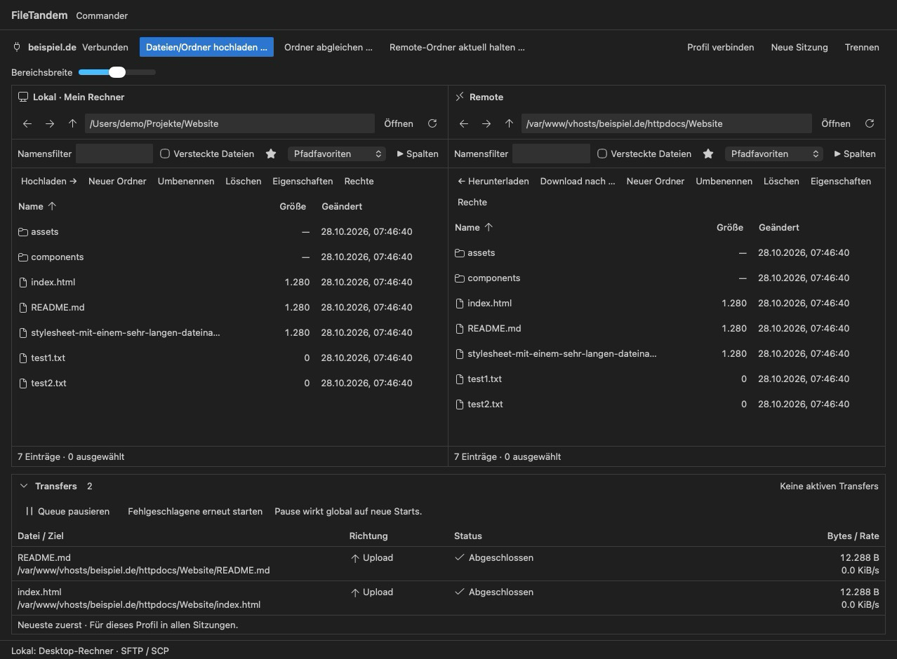

# FileTandem

Lokale Dateien und Serverdateien nebeneinander – direkt in Visual Studio Code. Mit FileTandem verwaltest du Dateien über **SFTP und SCP**, überträgst ganze Ordner und bearbeitest Remote-Dateien im Editor.

**[Aktuelle Version herunterladen](https://github.com/DrWhiteLetter/FileTandem/releases/latest)** · [Änderungen](CHANGELOG.md) · [Fehler melden](https://github.com/DrWhiteLetter/FileTandem/issues)



*Die Ansicht zeigt Beispieldaten.*

## Was kann FileTandem?

- Zwei Dateibereiche mit Filtern, Sortierung, Mehrfachauswahl und Pfadfavoriten.
- Dateien und Ordner hoch- und herunterladen, mit Transferqueue und SFTP-Fortsetzung.
- Serverprofile speichern; Anmeldung per Passwort, SSH-Schlüssel oder SSH-Agent.
- Remote-Dateien öffnen, Änderungen vergleichen und Bearbeitung gezielt freigeben.
- Ordner mit Vorschau abgleichen oder lokale Änderungen automatisch hochladen.
- Deutsche und englische Oberfläche passend zur VS-Code-Anzeigesprache, helle und dunkle Themes.

## Installation

1. Unter **[Releases](https://github.com/DrWhiteLetter/FileTandem/releases/latest)** die Datei `FileTandem-<Version>.vsix` herunterladen.
2. In VS Code die **Erweiterungen** öffnen und im Menü **… → Aus VSIX installieren …** die Datei auswählen.
3. Über die Befehlspalette **FileTandem: Dateimanager öffnen** starten.

Benötigt **VS Code Desktop ab 1.140.0**. Node.js ist für die Installation nicht nötig. FileTandem ist eine frühe Version; macOS mit Apple Silicon ist geprüft, Windows und Linux sind noch nicht vollständig getestet.

## Erste Verbindung

1. Über die Befehlspalette **FileTandem: Profil anlegen** ein Serverprofil mit Host, Benutzer und Anmeldeverfahren erstellen. Danach im Dateimanager **Profil verbinden** wählen.
2. Beim ersten Verbinden den angezeigten SSH-Fingerprint unabhängig beim Hoster oder Administrator prüfen und bestätigen.
3. Links den lokalen Ordner, rechts den Serverordner öffnen. Dateien auswählen und mit **Hochladen →** oder **← Herunterladen** übertragen.

Für SFTP genügt ein SFTP-Zugang; ein VS Code Server ist nicht erforderlich. SCP benötigt einen GNU/Linux-Server mit Shell und installiertem `scp`.

**Bitte beachten:** Remote-Löschungen sind endgültig. **Remote-Ordner aktuell halten …** spiegelt den lokalen Ordner einschließlich Löschungen auf den Server. Prüfe die Zielordner vor dem Start. [Mehr zum automatischen Upload](docs/automatischer-upload.md).

## Mitentwickeln

Mit Node.js ab 22.13.1 und npm:

```sh
npm ci
npm start
```

[Hinweise zur Mehrsprachigkeit](docs/mehrsprachigkeit.md).

`npm run quality` prüft den Code und baut die Erweiterung. `npm run package` erstellt die installierbare VSIX unter `out/`.

## Unterstützen & Lizenz

FileTandem hilft dir? [Unterstütze die Weiterentwicklung über PayPal](https://paypal.me/TobiasKohlhepp).

[MIT-Lizenz](LICENSE) · [Drittanbieterhinweise](THIRD_PARTY_NOTICES.md)
