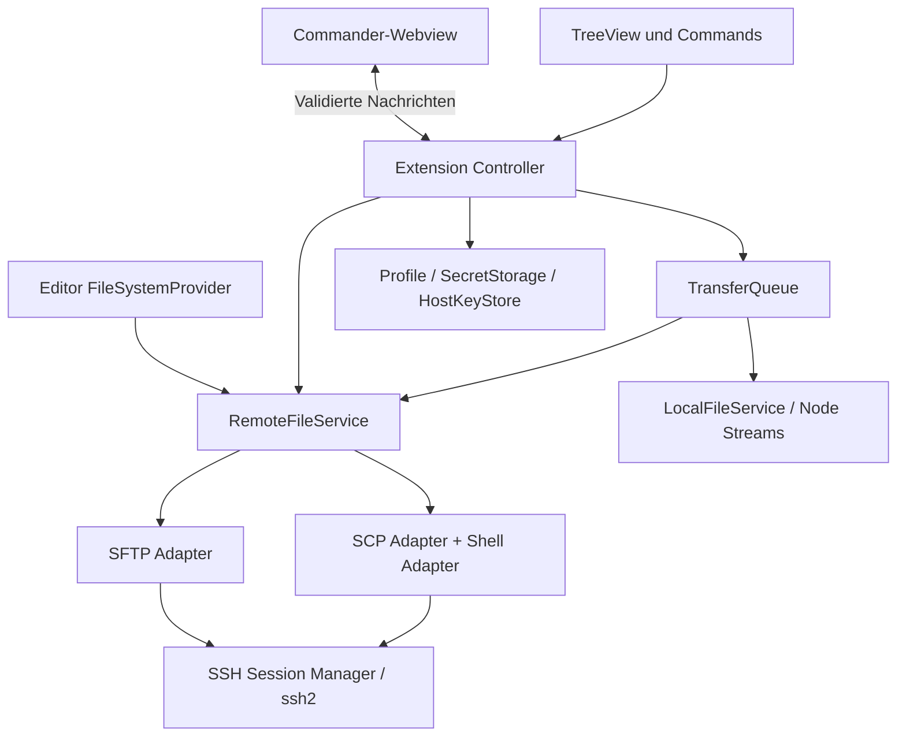

# xScp – VS-Code-Erweiterung: Recherche und Umsetzungsplan

Stand: 7. Oktober 2026, nach Abschluss von M3. Verbindliche Produktrichtung: VS-Code-Desktop-Erweiterung, SFTP als Standard und echtes SCP als zusätzliche Übertragungsart. Native macOS-Gestaltung und Swift/AppKit entfallen. M0 belegt die Adapter, Authentifizierung, Packaging sowie lokalen und echten Remote-Editor; die SFTP-Alpha bietet jetzt Dateiverwaltung, rekursive Transfers, Konfliktentscheidungen, Queue und Journal. SCP-Produktfad und geprüfter Wiederanlauf folgen in M4. Verbindliche technische Festlegungen stehen in [Entscheidungen](docs/entscheidungen.md), geprüfte Systeme und Release-Grenzen in [Kompatibilität](docs/kompatibilitaet.md). Der frühere native Plan unter `docs/archiv/UMSETZUNGSPLAN-native-macos.md` ist abgelöst. xScp bleibt die Entwicklungsidentität bis zur öffentlichen Produktprüfung.

Die konkrete Arbeitsliste mit einzelnen abhakbaren Aufgaben steht unter [Meilensteine zum Abarbeiten](docs/meilensteine/README.md).

## 1. Ziel und Produktentscheidungen

Ein WinSCP-vertrauter Dateimanager innerhalb von VS Code: links das lokale Dateisystem, rechts der SSH-Server, darunter Transferaufträge. VS-Code-Themes, Befehle und Editorintegration bestimmen die Gestaltung. Die Erweiterung soll auch ohne geöffneten Projektordner funktionieren.

Die erste vollständige Version enthält SFTP und SCP. Eine vorgezogene SFTP-Alpha dient der Erprobung und ersetzt diese Anforderung nicht. Keine Abhängigkeit von Remote-SSH auf dem Zielserver: Insbesondere muss SFTP-only ohne Shell und ohne installierten VS Code Server funktionieren.

| Entscheidung | Festlegung |
| --- | --- |
| Ausführung | Lokaler Node.js Extension Host, `extensionKind: ["ui"]` |
| Plattformen | Desktop: macOS zuerst, Windows und Linux vor Version 1.0 testen |
| Linker Bereich | Immer der Rechner, auf dem VS Code Desktop läuft |
| Oberfläche | Commander-Webview im Editorbereich plus native Verbindungs-TreeView |
| Protokolle | SFTP voreingestellt, SCP explizit auswählbar; kein stiller Fallback |
| SSH-Basis | `ssh2` 1.17.0, nach M0 freigegeben |
| Entwicklung | JavaScript (ES-Module), JSDoc, React für Webview, esbuild, npm mit Lockfile |
| Veröffentlichung | Installierbare VSIX zuerst; Marketplace nach Produktnamen-/Publisher-Klärung |
| Nicht Teil von 1.0 | Browser-Version, Synchronisierung, Terminal, Jump Hosts, automatischer Upload lokaler Projektdateien |

M0 hat diese Festlegungen geprüft: VS Code mindestens 1.140.0, Entwicklungs-Node 22.13.1, gebündelte SSH-/UI-Versionen exakt fixiert. macOS arm64 ist nachgewiesen; Windows/Linux bleiben konkrete Release-Gates. [Versionen und Nachweise](docs/kompatibilitaet.md).

## 2. Recherche und Konsequenzen

### WinSCP als Arbeitsablaufreferenz

WinSCPs Commander-Oberfläche kombiniert lokale und entfernte Dateibereiche mit eigener Navigation, Sitzungsauswahl und einer optionalen Transferliste. Diese räumliche Organisation wird übernommen. Werkzeugleisten und Auswahlverhalten werden an VS Code angepasst. [Commander-Oberfläche](https://winscp.net/eng/docs/ui_commander), [Transferliste](https://winscp.net/eng/docs/ui_queue)

### VS-Code-Oberfläche

Webviews erlauben eigene HTML-Oberflächen. Eine TreeView passt zu Serverprofilen, bietet aber nicht die gewünschte zweispaltige Detailtabelle. Deshalb wird die Hauptansicht ein `WebviewPanel`, kein Custom Editor: Sie repräsentiert eine Sitzung, keine Dokumentdatei. Einstellungen und Standarddialoge nutzen VS-Code-APIs. [Webview API](https://code.visualstudio.com/api/extension-guides/webview), [Tree View API](https://code.visualstudio.com/api/extension-guides/tree-view)

Webviews sollten nur dort eingesetzt werden, wo die vorhandenen Ansichten nicht ausreichen, und sich optisch in VS Code einfügen. Hier rechtfertigt die Commander-Ansicht die eigene Oberfläche. Das frühere Microsoft Webview UI Toolkit ist archiviert; wir planen keine Abhängigkeit davon. [UX Guidelines](https://code.visualstudio.com/api/ux-guidelines/webviews), [archiviertes Toolkit](https://github.com/microsoft/vscode-webview-ui-toolkit)

### Lokal, Remote und Browser

VS Code unterscheidet lokale, entfernte und browserbasierte Extension Hosts. `extensionKind: ["ui"]` passt zum benötigten Zugriff auf lokale Dateien und SSH-Agent. Eine Browser-Erweiterung hat diese Node.js-Möglichkeiten nicht. Unsere erste Version hat daher einen `main`-Einstieg und keinen `browser`-Einstieg. [Extension Host](https://code.visualstudio.com/api/advanced-topics/extension-host), [Web Extensions](https://code.visualstudio.com/api/extension-guides/web-extensions)

### SSH und Dateiübertragung

`ssh2` stellt SSH-Verbindungen, SFTP, Exec-Kanäle, Agent- und Schlüsselanmeldung bereit. Die API bietet eine eigene Host-Key-Prüfung; ohne `hostVerifier` werden Schlüssel automatisch akzeptiert. Wir müssen die Prüfung deshalb zwingend selbst anbinden. Optionale native Beschleunigung ist eine Packaging-Frage, keine Voraussetzung des Produktentwurfs. [ssh2](https://github.com/mscdex/ssh2)

Die SFTP-API bietet Lese-/Schreibstreams und Positionsangaben. Die reguläre VS-Code-Dateisystem-API liefert bei `readFile` hingegen den gesamten Inhalt. Daraus folgt: Große Transfers verwenden eigene Streams; der Editor-Provider ist nur für begrenzte Dateigrößen vorgesehen. [ssh2 SFTP](https://github.com/mscdex/ssh2/blob/master/SFTP.md), [VS Code API](https://code.visualstudio.com/api/references/vscode-api)

SCP benötigt zusätzliche Shell-Operationen zum Browsen. Das OpenSSH-Programm `scp` verwendet heute standardmäßig SFTP; nur ein Test mit deaktiviertem SFTP oder explizitem Legacy-Modus weist echtes SCP nach. [WinSCP: SCP](https://winscp.net/eng/docs/scp), [OpenSSH scp](https://man.openbsd.org/scp)

## 3. Zieloberfläche und Bedienung

```text
VS Code
├─ Activity Bar: xScp
│  └─ Verbindungen: Favoriten, gespeicherte Server, aktive Sitzungen
└─ Editor-Tab: xScp – server.example
   ┌──────────────────────────────────────────────────────────┐
   │ Verbinden  Hochladen →  ← Herunterladen  Neuer Ordner  ⋯  │
   ├───────────────────────────┬──────────────────────────────┤
   │ Lokal · Mein Rechner      │ user@server · SFTP           │
   │ ‹ › ↑ /Users/name/project │ ‹ › ↑ /var/www               │
   │ Filter…                   │ Filter…                      │
   ├───────────────────────────┼──────────────────────────────┤
   │ Name  Größe  Geändert     │ Name  Größe  Geändert Rechte │
   │ assets/                   │ assets/                      │
   │ index.html                │ index.html                   │
   ├───────────────────────────┴──────────────────────────────┤
   │ Transfers: 2 aktiv · 4 wartend                           │
   │ Datei / Richtung / Ziel / Fortschritt / Abbrechen        │
   └──────────────────────────────────────────────────────────┘
```

Ein Editor-Tab pro Sitzung; keine zusätzliche verschachtelte Tab-Leiste im Webview. Ein Verbindungsprofil kann mehrere Sitzungen öffnen. Jede Sitzung behält eigene Pfade, Sortierung und Auswahl. Eine globale Auftragsübersicht ist über einen Befehl erreichbar; die integrierte Liste ist standardmäßig auf die Sitzung gefiltert.

Details:

- Veränderbare Spalten und Bereichsbreiten, virtualisierte Zeilen, sichtbarer aktiver Bereich.
- Doppelklick auf Ordner navigiert; auf Dateien öffnet er die Editoransicht, ohne einen Upload auszulösen.
- Metadaten: Name, Größe, Typ, Änderungszeit; remote zusätzlich Rechte. Versteckte Dateien, Symlink-Kennzeichnung und clientseitiger Namensfilter.
- Aktionen über Buttons, Kontextmenüs und Command Palette. Richtung und tatsächlicher Zielpfad sind vor dem Transfer erkennbar.
- Standardtasten für Auswahl und Navigation; alle eigenen Shortcuts eng an Fokus/Context Keys binden. F5 bleibt standardmäßig VS-Code-Debugging. Ein optionales Commander-Profil darf F5 nur bei fokussierter Dateiliste übernehmen.
- Themes über `--vscode-*`-Variablen, Codicons, High Contrast, Zoom, Screenreader und vollständige Tastaturbedienung. Pfade und Status nicht ausschließlich durch Farbe unterscheiden.
- Interner Drag-and-drop zwischen den Dateibereichen als Komfortfunktion. Externes Finder-/Explorer-Dropping ist kein Releasekriterium: sichere Herkunftspfade sind in Webviews nicht durchgehend verfügbar. Dateiauswahl und „Herunterladen nach …“ sind die verlässlichen Alternativen.
- Remote-Dateinamen als Text rendern; niemals als HTML interpretieren.

## 4. Funktionsumfang nach Ausbaustufe

### A. SFTP-Alpha

Profile mit Host, Port, Benutzer, Startpfaden und Authentifizierung; Passwort und verschlüsselter Schlüssel; Host-Key-Vertrauen; lokale und entfernte Navigation; Upload/Download einzelner Dateien und Verzeichnisbäume; Queue; Überschreibentscheidungen; Abbruch und verständliche Fehler. Installierbar als VSIX.

### B. Vollständige Version 1.0

Zusätzlich echtes SCP, SSH-Agent und Keyboard-Interactive, Profile/Favoritenverwaltung, mehrere Sitzungen, Create/Rename/Delete, Eigenschaften und chmod, Remote-Dateien lesen/bearbeiten/vergleichen, Wiederherstellung unterbrochener Aufträge, geprüfte SFTP-Wiederaufnahme, plattformübergreifende Tests und barrierearme Oberfläche.

Dateitransfers verändern keine Zeilenenden. Zeitstempel nach Möglichkeit erhalten, neu angelegte Dateien berücksichtigen die Server-umask; keine automatische Übernahme von setuid/setgid. Symlinks werden beim rekursiven Transfer zunächst übersprungen und im Ergebnis ausgewiesen. Keine unbeabsichtigte Verfolgung außerhalb des gewählten Baums. Löschen ist separat implementiert und folgt Symlinks ebenfalls nicht.

Lokales Löschen nutzt nach Möglichkeit den Systempapierkorb; ein nicht verfügbarer Papierkorb führt zu einer ausdrücklichen Rückfrage. Remote-Löschen ist in 1.0 endgültig und zeigt Pfad und Umfang vor der Ausführung. Kein vorgetäuschtes globales Undo für Serveroperationen.

### C. Spätere Versionen

Synchronisierung mit Vorschau, sichere Upload-on-save-Workflows, SSH-config-Import einschließlich klarer Regeln für ausführbare Proxy-Konfigurationen, Jump Hosts, Terminalintegration, zusätzliche Server-Shell-Profile, virtuelle Workspaces und Transfer zwischen Workspace-Host und Zielserver. Browser-Unterstützung würde ein separates Gateway-Konzept benötigen.

## 5. Architektur und Datenfluss



- **Domain:** Modelle und Zustandsautomaten ohne Import von `vscode`, React oder SSH-Bibliothek.
- **Extension:** Befehle, Session-Lifecycle, Storage, Authentifizierungsdialoge und Workbench-Integration.
- **Transport:** asynchrone SSH-Adapter mit Timeouts, Cancellation und Fähigkeitenmodell.
- **Webview:** Präsentation; keine Zugangsdaten, privaten Schlüssel oder direkte Dateisystem-/Netzwerkzugriffe.

Ein Browserkanal und getrennte Transferressourcen verhindern, dass eine langsame Datei die Navigation blockiert. Startwert: zwei aktive Transfers pro Server; Ressourcenlimits und Backpressure explizit implementieren. Fortschrittsmeldungen zur Oberfläche auf ungefähr fünf Aktualisierungen pro Sekunde begrenzen. Keine Base64-Dateiinhalte über `postMessage`.

Nachrichten sind JavaScript-Objekte mit eindeutigem `type`-Feld, dokumentierten JSDoc-Datenstrukturen und Laufzeitvalidierung. Jede Anfrage trägt eine ID; UI-Aktionen referenzieren bekannte Sitzungen und Einträge. Der Host prüft Berechtigungen, Zielpfade und Session-Zugehörigkeit erneut. Die Webview erhält keinen generischen „Shell-Befehl ausführen“-Endpunkt.

### Vorgeschlagene Projektstruktur

```text
src/
  extension.js
  domain/          # Profile, FileEntry, TransferJob, Zustandsautomaten
  application/     # SessionManager, TransferQueue, Konfliktentscheidungen
  adapters/
    local/         # Streaming, Pfade, Metadaten
    ssh/           # Verbindungen, Host Keys, Authentifizierung
    sftp/          # SFTP-Dateioperationen
    scp/           # SCP-Protokoll und Shell-Fähigkeiten
    storage/       # Secrets, Profile, Journal
  vscode/          # Commands, TreeView, WebviewController, Provider
  shared/          # UI-Nachrichten und Validierung
webview/src/       # React, Tabellen, Queue, Theme-Anbindung
test/
  unit/
  integration/
  extension/
  fixtures/ssh/
docs/              # Architekturentscheidungen, Kompatibilität, Bedienung
```

Eine npm-Codebasis mit getrennten Bundles für Node und Browser genügt; kein Monorepo erforderlich. `vscode` bleibt beim Bundling external. Versionen werden nach Kompatibilitätsprüfung exakt im Lockfile fixiert. ESLint, JavaScript-Syntaxprüfung, automatisierte Tests und reproduzierbares Packaging gehören von Anfang an dazu. Der Quellcode verwendet `.js` und für React-Komponenten `.jsx`, keine `.ts`-/`.tsx`-Dateien. JSDoc dokumentiert wichtige Schnittstellen und unterstützt die Autovervollständigung. Eine `jsconfig.json` beschreibt die Projektstruktur. ES-Module werden durch esbuild in ein zur VS-Code-Laufzeit passendes Extension-Bundle und ein separates Browser-Bundle übersetzt; ein TypeScript-Compiler ist nicht erforderlich. Externe Daten und Webview-Nachrichten werden unabhängig von JSDoc zur Laufzeit validiert.

## 6. SSH-, SFTP- und SCP-Entscheidungen

### Gemeinsame Verbindungsschicht

Verbindungszustände: getrennt → verbinden → Host-Key prüfen → authentifizieren → bereit → gestört/getrennt. SHA-256-Fingerprint in OpenSSH-üblicher Base64-Darstellung. Unbekannte Keys ausdrücklich bestätigen; geänderte Keys blockieren und nur über eine separate bewusste Vertrauensänderung ersetzen. Port gehört zur Serveridentität. Verbindungs- und Übertragungssitzungen nutzen denselben Vertrauensentscheid.

Agent-Unterstützung für macOS/Linux über Unix-Socket; Windows-Agent-Anbindung wird in M0 getestet, bevor konkrete Unterstützung zugesagt wird. Ed25519, RSA mit aktuellen Signaturalgorithmen, verschlüsselte OpenSSH-Schlüssel und Keyboard-Interactive bilden die Testmatrix. Keine automatische Aktivierung veralteter Algorithmen, kein Agent Forwarding. Vollständiges `~/.ssh/config`-Verhalten wird nicht behauptet.

### SFTP

SSH-Subsystem verwenden; keine Shell voraussetzen. Streaming über `ssh2`-SFTP-Streams. Rename-Erweiterungen und andere Fähigkeiten erkennen. Fehler in gemeinsame Fehlerklassen übersetzen, zum Beispiel nicht vorhanden, keine Berechtigung, Verbindung verloren und Zielkonflikt.

### Echtes SCP

`ssh2` liefert Exec-Kanäle, aber keinen dokumentierten fertigen SCP-Transferadapter. M0-06 weist den gewählten begrenzten SCP-Sender/Empfänger über diese Kanäle nach; Integration und vollständige Härtung folgen in M4. SSH/Kryptografie werden nicht selbst implementiert. Der SCP-Parser ist ein eigenständiges, intensiv getestetes Modul und der größte technische Risikopunkt.

Für Version 1.0 zunächst Linux-Server mit POSIX-Shell, GNU find/coreutils und vorhandenem `scp`. Capability-Probe ermittelt Werkzeuge; unbekannte oder eingeschränkte Umgebungen werden präzise abgelehnt. BSD/macOS-, BusyBox- und Windows-SCP-Server sind zunächst nicht zugesagt.

- Verzeichnisse kontrolliert mit NUL-getrennten GNU-find-Metadaten auflisten; kein Parsing von formatiertem `ls -l`.
- Rekursion im Client: Verzeichnisse anlegen, einzelne Dateien übertragen. So bleiben Konflikte und Fortschritt pro Datei kontrollierbar.
- Transfer über serverseitiges `scp -t`/`scp -f`; sichere Shell-Quotierung und absolute Pfade. Keine Wildcard-Expansion.
- Header, Bestätigungen, exakte Byteanzahl, Fehlerkanal und Abschlussstatus prüfen; begrenzte Headergrößen, Größenvalidierung, unerwartete Dateinamen und Traversal ablehnen.
- Zeilenumbrüche und andere für diesen SCP-Weg nicht sicher darstellbare Dateinamen früh ablehnen; SFTP als Alternative nennen.
- Tests gegen einen Server mit deaktiviertem SFTP. Ein normaler `scp`-CLI-Test genügt nicht.

Ersatzweg bei gescheiterter SCP-Härtung in M4: getrennte Evaluierung eines gepflegten SCP-Adapters oder lokalem OpenSSH mit `-O`. Ein CLI-Wechsel muss Authentifizierung, Packaging und Prozessabbruch erneut lösen; er ist kein stiller Ersatz und kein Anlass, SCP aus 1.0 zu streichen.

## 7. Transfer-Engine, Konflikte und Wiederanlauf

Auftragszustände: wartend, vorbereiten, übertragen, Entscheidung nötig, finalisieren, erfolgreich, übersprungen, fehlgeschlagen, abgebrochen, unterbrochen. Sammelaufträge behalten Ergebnisse ihrer Einzeldateien; Teilfehler ergeben keinen Gesamterfolg.

1. Quelle und Ziel prüfen, Baum schrittweise entdecken. Bei unbekanntem Gesamtumfang zunächst unbestimmten Fortschritt zeigen.
2. Kollisionen behandeln: ersetzen, überspringen, beide behalten, abbrechen. „Für weitere Konflikte“ gilt nur im aktuellen Auftrag.
3. In eindeutig benannte temporäre Dateien am Ziel streamen; Quelle währenddessen auf erkennbare Änderung prüfen.
4. Länge und erfolgreichen Protokollabschluss prüfen. Hashvergleich gehört in die Tests; optionale Produktionsprüfsummen sind ein späterer Ausbau.
5. Vor Finalisierung Ziel erneut prüfen. Wenn verfügbar atomar umbenennen; vorhandene Dateien nie vorsorglich löschen. Fehlt atomare Ersetzung, sicheren Alternativnamen anbieten oder Auftrag stoppen. Keine universelle Atomarität behaupten.
6. Status und Verzeichnisansicht aktualisieren. Eigene Teil-Dateien behalten oder explizit bereinigen; keine fremden ähnlich benannten Dateien löschen.

SFTP-Resume: nur eigener dokumentierter Teiltransfer; Größen-/Zeitstempelprüfung allein beweist keine Inhaltsgleichheit. Vor Fortsetzung vorhandenen Präfix byteweise/über Hash vergleichen und Quelle erneut prüfen; andernfalls Neustart anbieten. Restrisiko einer gleichzeitig veränderten Quelldatei dokumentieren. SCP startet die betroffene Datei erneut.

Queue-Pause hält neue Jobs an; aktive Jobs können abgebrochen werden. Schließen eines Commander-Tabs beendet nicht die Queue. Schließen/Neuladen von VS Code unterbricht Transfers: kein Hintergrunddienst und keine verlässliche lange Shutdown-Phase. Journal laufend atomar schreiben; nach Neustart als „unterbrochen“ anzeigen und Fortsetzung ausdrücklich auslösen lassen. Kein automatisches Überschreiben nach Neustart.

Zielkonflikte innerhalb einer Extension-Instanz durch Pfadsperren verhindern. Mehrere VS-Code-Fenster haben getrennte Queues; serverseitige Paralleländerungen lassen sich ohne Serverunterstützung nicht vollständig ausschließen.

## 8. Remote-Dateien im Editor

Version 1.0 verwendet für SFTP einen eigenen `FileSystemProvider` mit URIs wie `xscp-remote://<sitzungs-id>/<pfad>`; die zufällige Sitzungs-ID wird intern einem Profil zugeordnet, URIs enthalten keine Zugangsdaten. Freigaben werden nicht über Profil- oder Fenstergrenzen geteilt. Er implementiert stat, readDirectory, readFile, writeFile, rename, delete, createDirectory und Änderungsereignisse. Semantik der create-/overwrite-Flags und VS-Code-Fehlertypen korrekt abbilden. [API-Referenz](https://code.visualstudio.com/api/references/vscode-api)

SCP-Dateien werden lokal heruntergeladen, im nativen lokalen Editor bearbeitet und ausdrücklich über die Transferqueue zurückgeladen. Auto Save dieser lokalen Kopie löst keinen SCP-Upload aus. Die Abnahme in M5 prüft beide Bearbeitungswege; ein direkter SCP-Provider-Speicherweg wird nicht zugesagt.

Editorzugriff und große Transfers bleiben getrennt. Startwert: maximal 10 MiB für Remote-Editorinhalte; größere Dateien per Transfer herunterladen. Diff mit `vscode.diff` auf lokalen und entfernten bzw. zwischengespeicherten Fassungen.

Sichere Bearbeitung:

- Remote-Dateien zunächst schreibgeschützt öffnen. „Bearbeitung aktivieren“ erklärt, dass Speichern direkt auf dem Server wirkt und Auto Save ebenfalls Schreibvorgänge auslösen kann.
- Schreibrechte pro URI/Sitzung verwalten; Provider-Eigenschaften und Verhalten in M0/M5 verifizieren.
- Beim Öffnen Referenzinhalt merken. Vor Schreiben entfernten Inhalt erneut vergleichen; bei Abweichung Konflikt statt stillem Überschreiben. Ohne serverseitiges Compare-and-swap bleibt ein kleines Rennen zwischen Prüfung und Rename möglich.
- Schreibvorgänge pro Ziel serialisieren und atomaren Uploadpfad der Transfer-Engine verwenden. Rückgabe erst nach erfolgreichem Serverabschluss.
- Verbindungsfehler lassen das Dokument ungespeichert. Manuelles Speichern und Auto Save durchlaufen dieselben Prüfungen.
- SFTP besitzt keinen allgemeinen Push-Watcher. Eigene Änderungen melden, aktive Dateien/Ordner begrenzt pollen; keine Echtzeitüberwachung des gesamten Servers zusagen.
- Remote-Workspace-Mounting und Kompatibilität aller Sprachserver sind kein Ziel der ersten Version.

## 9. Ausführungsorte und Plattformgrenzen

| Umgebung | Verhalten in Version 1.0 |
| --- | --- |
| VS Code Desktop, lokaler Ordner | Voll unterstützt |
| VS Code Desktop ohne Ordner | Voll unterstützt, lokalen Startordner auswählen |
| Desktop mit Remote-SSH/WSL/Dev Container | Erweiterung lokal installieren; links bleibt Desktop-Dateisystem |
| Remote-Workspace-Datei als Uploadquelle | Nicht in 1.0; keine falsche Interpretation von `vscode-remote:` als lokalem Pfad |
| Browser/vscode.dev/Codespaces im Browser | Nicht unterstützt |
| Codespaces über Desktop | Lokaler Dateimanager; Codespace-Dateien nicht automatisch linke Seite |

Explorer-Kontextmenü „Hochladen“ zunächst nur für echte lokale `file:`-URIs. Remote-Editor-Provider in Remote-Fenstern separat testen; bei Cross-Host-Einschränkungen dort deaktivieren, während die Transferansicht lokal weiter funktioniert. Grenzen in der UI benennen.

Windows erfordert eigene Tests für Laufwerke, UNC-Pfade, reservierte Dateinamen und Case-Kollisionen; Linux/macOS für Rechte, Symlinks und Dateisystem-Großschreibung. Remote-Pfade verwenden POSIX-Semantik, lokale Pfade die jeweilige Plattform. Unicode-Normalisierung und nicht verlustfrei darstellbare Namen dürfen nicht stillschweigend zusammengeführt werden.

## 10. Speicherung, Trust und Webview-Sicherheit

Profile in globalem Erweiterungsspeicher, Geheimnisse ausschließlich in `SecretStorage`, Host Keys separat. Profile enthalten Secret-Referenzen und Schlüsselpfade, keine Schlüsselkopien. Kein automatischer Settings-Sync für Profile, Keys oder Queue. Exporte enthalten standardmäßig nur nicht geheime Profildaten. `SecretStorage` wird nicht als macOS-Keychain-Direktanbindung oder als über Geräte synchronisiert beworben. [API-Referenz](https://code.visualstudio.com/api/references/vscode-api)

MVP-Regel für Workspace Trust: in nicht vertrauenswürdigen Workspaces keine Verbindungen und Dateiänderungen. Im Manifest `untrustedWorkspaces.supported: false` erklären; Tests mit aktivem Restricted Mode. Keine aus Projektdateien geladenen Shell-Kommandos, kein automatischer Upload beim Öffnen eines Projekts. Das ist eine bewusste Produktentscheidung auf Basis der Trust-API. [Workspace Trust](https://code.visualstudio.com/api/extension-guides/workspace-trust)

Webview: strikte CSP, lokale gebündelte Assets, beschränkte `localResourceRoots`, keine externen Skripte oder Inline-Handler. Zustandswiederherstellung mit `getState`/`setState` und Serializer; Transferzustand liegt im Host. `retainContextWhenHidden` nicht als Voraussetzung verwenden. [Webview API](https://code.visualstudio.com/api/extension-guides/webview)

Passwörter/Passphrasen nur über VS-Code-Passwortdialoge abfragen, nicht in React-Formularen. Diagnosekanal redigiert Geheimnisse und unnötige Serverdaten; kein Telemetrieversand in 1.0. Temporäre Editorinhalte mit restriktiven Dateirechten und klarer Bereinigung, soweit Dateien benötigt werden. Workspace Trust und SecretStorage ersetzen keine Prüfung von Drittanbieterabhängigkeiten.

## 11. Manifest und Integration

Geplante Beiträge: Activity-Bar-Container, Profil-TreeView, Commands, Explorer-Kontextmenü, eng gebundene Keybindings, Einstellungen und lokalisierte Strings (Deutsch/Englisch). Lazy Activation über verwendete Commands/Views, Webview-Wiederherstellung und Dateisystemschema. Kein pauschales `*`-Activation-Event. Nur stabile APIs. [Extension Manifest](https://code.visualstudio.com/api/references/extension-manifest)

Befehle mit vorläufigem Präfix `xscp`: openManager, addConnection, connect, disconnect, upload, download, refresh, newFolder, rename, delete, properties, openRemoteFile, enableEditing, compare, showTransfers, cancelTransfer und retryTransfer. Namen vor öffentlicher Veröffentlichung zentral ersetzen können.

Einstellungen: Parallelität, Timeout/Keepalive, versteckte Dateien, Queue-Darstellung, Editor-Größenlimit und optionales Commander-Profil. Host und Zugangsdaten gehören nicht in Workspace-Settings. Profiländerungen erhalten Schemas und Migrationen.

## 12. Tests und Abnahme

### Automatisierte Ebenen

- Unit-Tests: Pfade, Namenskollisionen, Queue-Zustände, Konfliktregeln, Nachrichtenvalidierung und SCP-Parser einschließlich zerstückelter/missgebildeter Pakete. Parser zusätzlich mit zufällig variierten Eingaben testen.
- SSH-Integration: isolierte OpenSSH-Container/VMs mit SFTP, SFTP-only ohne Shell, deaktiviertem SFTP für SCP, falschen Keys und eingeschränkten Rechten. Testschlüssel sind ausschließlich Fixtures.
- Extension-Tests über das nachgewiesene `@vscode/test-electron` mit eigenem Host-Harness, `node:test` für Unit-/Protokolltests, Mindestversion und geprüftem aktuellem Stable. Kein zusätzlicher Test-CLI-/Mocha-Zwang. Trust-Zustände mit getrennten Benutzerprofilen. [Testing Extensions](https://code.visualstudio.com/api/working-with-extensions/testing-extension)
- Webview-Komponententests plus Browser-Interaktionstests für Auswahl, Virtualisierung und Konfliktdialoge; zusätzlich echte VS-Code-Smoke-Tests für Messaging und Commands. Ein Browser-Harness allein gilt nicht als Extension-Abnahme.
- CI auf macOS/Windows/Linux; Linux-SSH-Fixtures für Protokolltests, Plattformtests mit erreichbarem isoliertem Testserver. Apple-Silicon-Smoke-Test auf passender Hardware.

### Pflichtfälle

Leere Datei; Datei über 4 GiB; 10.000 Verzeichniseinträge; viele kleine Dateien; Leerzeichen, Quotes und Shell-Sonderzeichen; Unicode; Zeilenumbrüche; Symlinks/Schleifen; Case-Kollisionen; volle Datenträger; fehlende Rechte; Netzabbruch; Ruhezustand; Abbruch beim Finalisieren; Serveränderung während Editorbearbeitung; Auto Save; geänderter Host Key; zwei VS-Code-Fenster.

Dateiinhalte nach Upload/Download per Hash vergleichen. Speicherverbrauch großer Transfers darf nicht proportional zur Dateigröße wachsen. Planungsziel: 4-GiB-Einzeltransfer mit weniger als 128 MiB zusätzlichem RSS auf dokumentierter Referenzhardware; UI bleibt währenddessen bedienbar. Verzeichnisgröße und RTT bei Performance-Berichten angeben.

Abnahme 1.0: frische VSIX-Installation ohne zusätzliche npm-/SSH-Bibliotheksinstallation; beide Protokolle bidirektional bewiesen; keine unbestätigte Host-Key-Änderung; vorhandene Ziele bei Transferfehlern erhalten; keine Geheimnisse in Logs/Webview; vollständiger Tastaturpfad und High-Contrast-Prüfung; README beschreibt Plattform- und SCP-Grenzen.

## 13. Meilensteine und Aufwand

Aktualisierte Schätzung nach M0 für eine erfahrene Vollzeitkraft, keine feste Terminzusage. Tage sind Personenarbeitstage. M0 ist abgeschlossen; sein früheres 4–6-Tage-Budget ist keine gemessene Ist-Zeit. M1–M6 sind verbleibender Aufwand. [Begründung und Vergleich](docs/entscheidungen.md#d10--aufwand-und-übergang-in-m1). Die Reihenfolge minimiert das Risiko, erst nach dem UI-Bau an SCP oder Extension-Host-Grenzen zu scheitern.

| Meilenstein | Ergebnis / Abnahme | Aufwand |
| --- | --- | --- |
| M0: Technische Nachweise | Lokaler Host auch im Remote-Fenster; ssh2-Build ohne native Pflichtmodule; Host Keys; Auth-Matrix; SFTP und echtes SCP; Shell-Probe; Editor-Provider-Minimaltest; Versionsmatrix dokumentiert | abgeschlossen; 0 Resttage |
| M1: Extension-Grundgerüst | Manifest, Build, CI, VSIX, Profil-TreeView, Commands, Mock-Commander mit Themes und Fokus | 3–5 Tage |
| M2: Verbindungen und Dateibrowser | SecretStorage, Profile, SFTP-Navigation, CRUD, native Dialoge, lokale Pfade, Fehlerbehandlung | 4–6 Tage |
| M3: Transfer-Engine / Alpha | Streaming, Rekursion, Konflikte, Teil-Dateien, Queue, Abbruch, Journal; nutzbare SFTP-VSIX | 7–10 Tage |
| M4: SCP und Wiederanlauf | Gehärteter SCP-Adapter, GNU-Shell-Profil, negatives SFTP-Testsystem, sichere Resume-Prüfung und Wiederanlauf | 6–9 Tage |
| M5: Editor und Bedienung | Provider, Read-only/Editing, Diff, externe Änderungskonflikte, Sitzungen, interne Drag-and-drop-Aktionen, Accessibility | 5–7 Tage |
| M6: Release-Härtung | Plattformmatrix, große Dateien, Fehlerfälle, VSIX-Inspektion, Dokumentation und Release-Kandidat | 6–9 Tage |

Restaufwand M1–M6: **31–46 Tage**, mit 20 % Reserve aufgerundet **38–56 Arbeitstage**, etwa 8–12 Vollzeitwochen. SFTP-Alpha ab jetzt (M1–M3): 14–21 Tage ohne Reserve, 17–26 mit Reserve. Vergleichbarer Gesamtrahmen einschließlich des früheren M0-Budgets: 35–52 Tage, mit Reserve 42–63. Verfügbare Plattform-Testsysteme vorausgesetzt; Wartezeit und Scope-Erweiterungen sind nicht eingerechnet.

Abhängigkeiten: M0 → M1 → M2 → M3; M4 benötigt M0/M3; M5 benötigt M2/M3; M6 benötigt alle. Jede Phase endet mit einer ausführbaren VSIX oder einem dokumentierten technischen Nachweis. Kein Marketplace-Release aus einem nicht geprüften Zwischenstand.

## 14. Packaging, Betrieb und Veröffentlichung

`@vscode/vsce` zum Paketieren. VSIX-Inhalt kontrollieren: keine Testschlüssel, Testserver, privaten Pfade, Zugangsdaten oder unnötigen Entwicklungsdateien. README, CHANGELOG, Lizenz, Drittanbieterhinweise, Icon und Screenshots vorbereiten. `engines.vscode` entspricht der tatsächlich getesteten Untergrenze. [Publishing Extensions](https://code.visualstudio.com/api/working-with-extensions/publishing-extension)

Bevorzugt ein plattformunabhängiges Paket ohne native Pflichtmodule. Falls der Performance-Prototyp native Komponenten notwendig macht, separate Plattformpakete und Buildmatrix einplanen. Anwender benötigen kein separat installiertes Node.js; verwendet wird die VS-Code-Laufzeit.

Zunächst lokale/private VSIX-Verteilung. Öffentliche Veröffentlichung benötigt finalen Namen, Publisher-ID, Benutzerkonto und Zugang zur Registry; diese Voraussetzungen blockieren die Entwicklung nicht. Marketplace-Authentifizierung zum Release nach aktueller offizieller Anleitung einrichten, bevorzugt kurzlebige föderierte Credentials. Open VSX ist ein optionaler späterer Vertriebskanal.

Versionsschema: 0.x für Alpha/Beta, 1.0 nach vollständiger Abnahme. Vorabversion und stabile Version trennen; Datenmigrationen vorwärtsverträglich planen. Abhängigkeiten regelmäßig auf Sicherheitsmeldungen prüfen. Fehlerberichte enthalten Extension-/VS-Code-Version und bereinigte Diagnosen. Keine automatische Veröffentlichung im Rahmen dieses Planungsauftrags.

## 15. Übergang nach M0 und externe Voraussetzungen

M0-01 bis M0-09 sind abgeschlossen. Beide Protokollwege sind tragfähig, der lokale Host im echten Remote-Fenster ist nachgewiesen, die Mindestversion und Ersatzwege sind entschieden. [Abschlussnachweis](docs/nachweise/M0-09.md).

Nächste Arbeit: M1-01 – Module und Qualitätsbefehle strukturieren, vorhandene M0-Adapter übernehmen, anschließend Manifest/Mock-Commander/CI ergänzen. Keine weitere technische Grundsatzfreigabe ist dafür erforderlich. Windows/Linux/Agent, größere Dateien, produktive Transferfinalisierung und vollständige Bedienabnahme bleiben den fest zugeordneten M1–M6-Items vorbehalten.

Vor öffentlichem Release noch erforderlich: finaler Produktname/Identifier, Umsetzung der gewählten MIT-Lizenz und ein tatsächlich verfügbarer Publisher. Diese Punkte werden erst dann entscheidend; die technische Umsetzung kann mit dem Arbeitstitel beginnen.
